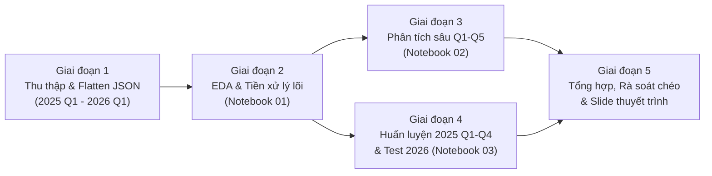

# Phân tích Sự cố Bất lợi Thuốc Thú y (2025) & Dự báo Mức độ Nghiêm trọng năm 2026 (Q1)
*(OpenFDA Animal & Veterinary Adverse Events Analysis & Temporal Prediction)*

> **Đồ án cuối kỳ môn học:** CSC17104 – Lập trình cho Khoa học Dữ liệu (Programming for Data Science)  
> **Trường:** Đại học Khoa học Tự nhiên, ĐHQG-HCM (FIT@HCMUS)  
> **Nhóm thực hiện:** Global Ban (`Prg4DS-G3`)

---

## Mục lục
1. [Thành viên nhóm](#1-thành-viên-nhóm)
2. [Mô tả bộ dữ liệu & Phạm vi thời gian (2025–2026 Q1)](#2-mô-tả-bộ-dữ-liệu--phạm-vi-thời-gian-20252026-q1)
3. [Cấu trúc thư mục dự án](#3-cấu-trúc-thư-mục-dự-án)
4. [Hệ thống 6 câu hỏi nghiên cứu & Phân công](#4-hệ-thống-6-câu-hỏi-nghiên-cứu--phân-công)
5. [Kế hoạch vận hành chi tiết (Operational Plan)](#5-kế-hoạch-vận-hành-chi-tiết-operational-plan)
6. [Các phát hiện chính (Key Findings)](#6-các-phát-hiện-chính-key-findings)
7. [Hướng dẫn cài đặt và chạy dự án](#7-hướng-dẫn-cài-đặt-và-chạy-dự-án)
8. [Cam kết học thuật & Khai báo sử dụng AI](#8-cam-kết-học-thuật--khai-báo-sử-dụng-ai)

---

## 1. Thành viên nhóm

| Mã TV | Họ và Tên | MSSV | Vai trò chính | Phụ trách câu hỏi | Phản biện chéo (Reviewer) |
|:---:|---|---:|---|---|:---:|
| **M1** | **Đinh Công Khang** | `24120332` | Quản lý cấu trúc Repo, Pipeline tích hợp 4 quý năm 2025, Mô hình Học máy (ML) | **Q1**, **Q6 (ML)** | M3 (Kiệt) |
| **M2** | **Trần Ngô Uyên Nhi** | `24120210` | Chuẩn hóa đơn vị sinh học (tuổi/cân nặng), Phân tích thời gian & đối tượng báo cáo, Chuẩn hóa trực quan hóa | **Q2**, **Q5** | M1 (Khang) |
| **M3** | **Huỳnh Tuấn Kiệt** | `24120356` | Xác minh schema/license, Làm phẳng cấu trúc JSON `drug`/`reaction`/`outcome`, Kiểm định thống kê & độ vững | **Q3**, **Q4** | M2 (Nhi) |

---

## 2. Mô tả bộ dữ liệu & Phạm vi thời gian (2025–2026 Q1)

### 2.1. Xác minh Giấy phép (License), Tác giả & Nguồn gốc (Provenance)
- **Tên bộ dữ liệu:** OpenFDA Animal & Veterinary Adverse Events (`animalandveterinary/event`).
- **Tác giả / Tổ chức thu thập & công bố (Author & Publisher):** **U.S. Food and Drug Administration (FDA) – Center for Veterinary Medicine (CVM)**, trực thuộc Bộ Y tế và Dịch vụ Nhân sinh Hoa Kỳ (U.S. Department of Health and Human Services — HHS). Hệ thống gốc là cơ sở dữ liệu giám sát hậu mại **CVM Adverse Drug Experience (ADE)**, được trích xuất và công bố qua nền tảng dữ liệu mở **openFDA**.
- **Nguồn gốc & Đường dẫn truy cập chính thức (Source & Manifest):**
  - Cổng tải dữ liệu hàng loạt (Bulk Downloads): [https://open.fda.gov/data/downloads/](https://open.fda.gov/data/downloads/) (mục **Animal and Veterinary $\rightarrow$ Animal and Veterinary Event**).
  - Manifest JSON chính thức (chứa danh sách phân vùng, ngày xuất `export_date`, số bản ghi và URL tải trực tiếp): [`https://api.fda.gov/download.json`](https://api.fda.gov/download.json) (khóa `results.animalandveterinary.event`).
  - Tài liệu đặc tả API & Schema: [https://open.fda.gov/apis/animalandveterinary/event/](https://open.fda.gov/apis/animalandveterinary/event/).
- **Xác minh Giấy phép (License Verification — CC0 1.0 Universal):**
  - **Giấy phép:** **Creative Commons CC0 1.0 Universal (Public Domain Dedication)** — xác minh trực tiếp tại [https://open.fda.gov/license/](https://open.fda.gov/license/), trong trường `meta.license` của mọi tệp JSON tải về, và văn bản pháp lý tại [https://creativecommons.org/publicdomain/zero/1.0/](https://creativecommons.org/publicdomain/zero/1.0/).
  - **Quyền sử dụng:** Dữ liệu thuộc phạm vi công cộng (Public Domain), cho phép sao chép, chỉnh sửa, phân phối và khai thác tự do cho mục đích học thuật/nghiên cứu mà không bị ràng buộc bản quyền.
  - **Điều khoản & Miễn trừ trách nhiệm bắt buộc (Terms & Disclaimer):** Tuân thủ [openFDA Terms of Service](https://open.fda.gov/terms/). Theo trường `meta.disclaimer` trong mỗi tệp dữ liệu: *(1) Không sử dụng dữ liệu openFDA làm căn cứ duy nhất để ra quyết định điều trị thú y hay lâm sàng; (2) FDA không tự động xác minh độc lập nguyên nhân – kết quả của từng báo cáo riêng lẻ; (3) Khi trích dẫn cần ghi rõ nguồn từ openFDA / FDA CVM.*
- **Định dạng gốc:** Các tệp nén `.json.zip` phân vùng theo từng quý (`YYYYq1`–`YYYYq4`), bên trong gồm đối tượng `meta` (chứa `disclaimer`, `license`, `last_updated`, `results.total`) và mảng `results[]` có cấu trúc JSON lồng nhau sâu.

### 2.2. Phương pháp thu thập, Quần thể & Phạm vi thời gian (Collection Method, Population & Period)
- **Phương pháp thu thập dữ liệu (Collection Method — Giám sát Cảnh giác dược Thú y):**
  *(Lưu ý: Khác với đề xuất ban đầu ở giai đoạn tiền khả thi dùng dữ liệu viễn thám/khảo sát thực địa, bộ dữ liệu chính thức của nhóm được thu thập qua hệ thống **Giám sát Cảnh giác dược Thú y — Veterinary Pharmacovigilance** của FDA CVM từ hai kênh chính)*:
  1. **Báo cáo bắt buộc từ nhà sản xuất (Mandatory Reporting — 21 CFR 514.80):** Các hãng dược và nhà tài trợ thuốc thú y được FDA cấp phép (NADA/ANADA) có nghĩa vụ pháp lý phải thu thập và gửi báo cáo sự cố bất lợi về FDA CVM (bao gồm báo cáo khẩn 15 ngày — *15-day Alert Reports* trên biểu mẫu **Form FDA 1932** và báo cáo định kỳ) qua cổng điện tử **FDA Electronic Submissions Gateway (ESG / ESG NextGen — Electronic Submission System)** với chuẩn bản tin điện tử **HL7 ICSR** theo hướng dẫn quốc tế **VICH GL35** (*CVM GFI #214*).
  2. **Báo cáo tự nguyện từ thực tế lâm sàng (Voluntary / Spontaneous Reporting):** Bác sĩ thú y (`Veterinarian`), chủ vật nuôi (`Animal Owner`), người chăn nuôi và nhân viên y tế khác gửi báo cáo tự nguyện bằng cách thông báo cho hãng sản xuất (để hãng chuyển tiếp về FDA), hoặc gửi trực tiếp cho FDA CVM qua biểu mẫu PDF **Form FDA 1932a** (*"Veterinary Adverse Drug Reaction, Lack of Effectiveness, or Product Defect Report"*) hay bảng câu hỏi trực tuyến **Rational Questionnaire** trên cổng **Safety Reporting Portal (SRP)**.
  3. **Chuẩn hóa thuật ngữ chuyên ngành:** Trước khi phát hành lên openFDA, các triệu chứng và phản ứng lâm sàng được mã hóa theo từ điển chuẩn quốc tế **VeDDRA** (*Veterinary Dictionary for Drug Regulatory Activities*), và thuốc được ánh xạ theo hệ thống phân loại **ATCvet** của Tổ chức Y tế Thế giới (WHO).
- **Quần thể nghiên cứu & Đơn vị quan sát (Population & Unit of Observation):**
  - **Quần thể mục tiêu (Target Population):** Các trường hợp động vật (thú cưng như Chó, Mèo; ngựa; gia súc, gia cầm và các loài vật nuôi khác) sử dụng thuốc thú y, chế phẩm sinh học hoặc thiết bị thú y (chủ yếu tại Hoa Kỳ hoặc do nhà sản xuất đăng ký với FDA báo cáo) gặp biến cố bất lợi (`Safety Issue`), thiếu hụt hiệu quả mong đợi (`Lack Of Expected Effectiveness`) hoặc lỗi chất lượng sản phẩm (`Product Defect`).
  - **Đơn vị quan sát (Unit of Observation):** Mỗi bản ghi trong `results[]` (định danh bởi khóa chính `unique_aer_id_number`) là **một báo cáo sự kiện bất lợi (Adverse Event Report)**. Một báo cáo thường đại diện cho 1 cá thể bệnh (phổ biến ở thú cưng: Chó, Mèo) nhưng cũng có thể đại diện cho một nhóm/đàn vật nuôi được điều trị cùng lúc (`number_of_animals_affected > 1`, thường gặp ở gia súc, gia cầm, thủy sản).
- **Phạm vi thời gian (Temporal Period — 2025 Q1 đến 2026 Q1):**
  Dù cơ sở dữ liệu lịch sử của openFDA lưu trữ từ năm 1987, đồ án tập trung vào **5 phân vùng quý liên tiếp mới nhất (`2025q1` $\rightarrow$ `2026q1`)** để phản ánh đúng thực trạng thuốc thú y hiện hành:
  1. **Giai đoạn Phân tích & Huấn luyện (2025 Q1 – Q4):**
     - Bao gồm **4 phân vùng quý** (`2025q1`, `2025q2`, `2025q3`, `2025q4`).
     - Sử dụng để trả lời 5 câu hỏi phân tích chuyên sâu (Q1–Q5) và làm **Tập Huấn luyện + Kiểm định chéo theo thời gian (Training & Temporal Validation Set)** cho bài toán Học máy (Q6).
  2. **Giai đoạn Dự báo & Kiểm thử Thực tế (2026 Q1):**
     - Bao gồm **phân vùng quý đầu tiên của năm 2026 (`2026q1`)**.
     - Đóng vai trò là **Tập Kiểm thử Ngoài Thời gian (Out-of-Time Test Set)** hoàn toàn độc lập để:
       - Đối chiếu xem xu hướng phản ứng bất lợi đầu năm 2026 có tiếp nối quy luật năm 2025 hay xuất hiện dịch chuyển phân phối (*data/concept drift*).
       - Đánh giá khách quan khả năng tổng quát hóa của mô hình học máy theo chuẩn **Time-based Split** tại Mục 3.3 của đề cương đồ án.

### 2.3. Các hạn chế và thiên lệch đã biết (Limitations & Known Biases)
Do đặc thù của hệ thống báo cáo cảnh giác dược hậu mại, bộ dữ liệu có **6 hạn chế và thiên lệch cốt lõi** cần luôn được lưu ý khi diễn giải kết quả:
1. **Thiếu mẫu số phơi nhiễm (Lack of Denominator / No Exposure Data):** Dữ liệu chỉ chứa các ca **có xảy ra và được báo cáo sự cố**, hoàn toàn không có tổng số cá thể động vật đã dùng thuốc an toàn hoặc doanh số liều thuốc bán ra. Vì vậy, **không thể tính tỷ lệ mắc bệnh tuyệt đối (incidence rate / absolute risk)**; nhóm chỉ kết luận về tỷ trọng trong tập báo cáo hoặc sử dụng **Tỷ số chênh báo cáo (Reporting Odds Ratio — ROR)**.
2. **Không thiết lập quan hệ nhân quả trực tiếp (No Proof of Causality):** Một báo cáo ghi nhận thuốc $A$ và phản ứng $B$ chỉ phản ánh sự kết hợp về mặt thời gian (*temporal association*), không chứng minh thuốc $A$ gây ra phản ứng $B$. Phản ứng có thể bắt nguồn từ bệnh lý nền, tuổi già, tương tác đa thuốc (*polypharmacy*) hoặc sai sót khi dùng thuốc (*off-label*).
3. **Báo cáo thiếu & Thiên lệch mức độ nghiêm trọng (Under-reporting & Severity/Stimulated Reporting Bias):** Chỉ một phần nhỏ các phản ứng phụ ngoài thực tế được gửi về FDA. Các biến cố nặng (`serious_ae = true`, tử vong), thuốc vừa mới cấp phép (*Weber effect*), hoặc thuốc đang có cảnh báo an toàn từ truyền thông/FDA có xác suất được báo cáo cao hơn hẳn các phản ứng nhẹ thoáng qua.
4. **Thiên lệch theo loài và hành vi người báo cáo (Species & Reporter Bias):** Thú cưng trong gia đình (đặc biệt là Chó và Mèo) được chăm sóc cá thể hóa nên chiếm tỷ trọng áp đảo trong cơ sở dữ liệu so với vật nuôi trang trại. Bên cạnh đó, báo cáo từ Bác sĩ thú y (`Veterinarian`), Chủ vật nuôi (`Animal Owner`) và Hãng dược khác biệt rõ rệt về độ đầy đủ lâm sàng, thuật ngữ mô tả và độ trễ gửi báo cáo (`reporting_delay_days`).
5. **Khử trùng lặp phòng ngừa theo `unique_aer_id_number` & Phân biệt với `report_id` (Precautionary Deduplication & Identifier Distinction):** Về mặt lý thuyết, khi một ca bệnh có thêm thông tin bổ sung (follow-up), hồ sơ có thể được cập nhật lại với cùng mã báo cáo `unique_aer_id_number`. Dù kiểm tra thực tế trên các cặp phân vùng quý liền kề (`2025q1` $\leftrightarrow$ `2025q2`, `2025q4` $\leftrightarrow$ `2026q1`) ghi nhận `0` bản ghi trùng `unique_aer_id_number`, `src/data_loader.py` vẫn thực hiện bước **khử trùng lặp phòng ngừa** theo khóa `unique_aer_id_number` (giữ bản ở quý/file muộn nhất). **Lưu ý quan trọng:** Chỉ khử trùng lặp theo `unique_aer_id_number`, tuyệt đối **không** dedupe theo `report_id`, vì `report_id` là mã số hồ sơ đăng ký thuốc NADA/ANADA (ví dụ: `N141302`, `N141272`) — nhiều ca bệnh độc lập của cùng một thuốc sẽ có chung `report_id` (ví dụ `2025q4` $\leftrightarrow$ `2026q1` có 311 mã `report_id` trùng nhau).
6. **Dữ liệu khuyết không ngẫu nhiên & Đơn vị đo lường hỗn hợp (Missingness & Heterogeneous Units):** Nhiều trường thông tin (`onset_date`, `age`, `weight`, `serious_ae`, `off_label_use`) bị khuyết theo cơ chế phụ thuộc vào người báo cáo hoặc loại thông tin (MAR/MNAR). Ngoài ra, tuổi (`Day`, `Week`, `Month`, `Year`) và cân nặng (`Kilogram`, `Pound`, `Gram`, `Ounce`) được lưu ở nhiều đơn vị khác nhau, bắt buộc phải chuẩn hóa trước khi phân tích.

### 2.4. Cấu trúc Schema JSON lồng nhau & Thiết kế 4 Bảng Quan hệ Phẳng
Mỗi phần tử trong `results[]` đại diện cho một báo cáo sự kiện (định danh duy nhất bởi `unique_aer_id_number`; không nhầm với `report_id` là mã đăng ký thuốc NADA/ANADA). Để tránh bùng nổ tổ hợp (Cartesian explosion) khi một báo cáo chứa nhiều thuốc (`drug[]`), nhiều triệu chứng (`reaction[]`) và nhiều kết cục (`outcome[]`), nhóm thiết kế quy trình **flatten/normalize** (trong `src/data_loader.py`) thành 4 bảng chuẩn hóa định dạng `.csv` lưu tại `data/processed/` (các biến dẫn xuất như `year`, `age_years`, `weight_kg`, `life_stage`, `reporting_delay_days` được tạo ở bước tiền xử lý):

| Bảng chuẩn hóa | Khóa chính / Khóa ngoại | Các trường thông tin cốt lõi (khớp output của `src/data_loader.py`) |
|---|---|---|
| **`reports.csv`** | `unique_aer_id_number` (PK) | `report_id` (mã NADA/ANADA), `original_receive_date`, `onset_date`, `primary_reporter`, `secondary_reporter`, `type_of_information`, `serious_ae`, `treated_for_ae`, `number_of_animals_affected`, `number_of_animals_treated`, thông tin phẳng hóa từ `animal` (`species`, `gender`, `reproductive_status`, `female_physio_status`, `age_min`, `age_max`, `age_unit`, `age_qualifier`, `weight_min`, `weight_max`, `weight_unit`, `weight_qualifier`, `is_crossbred`, `breed_component`), `duration_value`, `duration_unit`, `health_prior_condition`, `health_prior_assessed_by`, `quarter`, `source_file` |
| **`drugs.csv`** | `unique_aer_id_number` (FK) | `drug_idx`, `active_ingredients` (tên hoạt chất nối bằng `';'`), `brand_name`, `dosage_form`, `route`, `atc_vet_code`, `manufacturer_name`, `used_according_to_label`, `off_label_use`, `lot_number`, `lot_expiration`, `dose_numerator`, `dose_numerator_unit`, `dose_denominator`, `dose_denominator_unit`, `frequency_value`, `frequency_unit`, `quarter`, `source_file` |
| **`reactions.csv`** | `unique_aer_id_number` (FK) | `veddra_term_code`, `veddra_term_name`, `veddra_version`, `number_of_animals_affected`, `accuracy`, `quarter`, `source_file` |
| **`outcomes.csv`** | `unique_aer_id_number` (FK) | `medical_status` (`Recovered/Normal`, `Died`, `Euthanized`, `Ongoing`, `Unknown`), `number_of_animals_affected`, `quarter`, `source_file` |

### 2.5. Khai báo các công trình/notebook công khai liên quan & Điểm khác biệt (Declare Existing Work)

Nhóm đã khảo sát các công trình nghiên cứu, kho mã nguồn và công cụ phân tích công khai liên quan đến bộ dữ liệu **openFDA Animal & Veterinary Adverse Events**:

| STT | Công trình / Kho mã nguồn / Tài liệu công khai | Nội dung & Cách tiếp cận chính | Điểm khác biệt cốt lõi trong đồ án của nhóm **Global Ban** |
|:---:|---|---|---|
| 1 | **Cổng khám phá tương tác chính thức của openFDA**<br>([openFDA Animal & Veterinary Interactive Chart](https://open.fda.gov/apis/animalandveterinary/event/explore-the-api-with-an-interactive-chart/)) | Cung cấp giao diện truy vấn API trực tuyến và biểu đồ cột đếm tần suất đơn biến (Top `animal.species`, Top `primary_reporter`, Top `reaction.veddra_term_name` trên toàn bộ lịch sử). | Đi xa hơn thống kê đếm đơn biến: nhóm thực hiện **chuẩn hóa đa bảng**, quy đổi đơn vị sinh trắc học (`age_years`, `weight_kg`), **kiểm soát biến nhiễu (D4)** và **ước lượng khoảng tin cậy / kiểm định giả thuyết (D5)** thay vì chỉ nhìn tần suất thô. |
| 2 | **Kho mã nguồn hạ tầng, Thư viện AI Skills & Công cụ truy vấn trên GitHub**<br>([`FDA/openfda`](https://github.com/FDA/openfda), [`OpenVet-Projects/VetClaw`](https://github.com/OpenVet-Projects/VetClaw), [`api-evangelist/openfda`](https://github.com/api-evangelist/openfda)) | Tập trung vào pipeline nạp dữ liệu backend (`FDA/openfda` — `animalandveterinarydrugevent`), thư viện kỹ năng (skills) AI thú y có tích hợp SDK client cho openFDA (`OpenVet-Projects/VetClaw`), hoặc đặc tả API/wrapper tra cứu qua REST API (`api-evangelist/openfda`). | Xây dựng **pipeline dữ liệu tái lập hoàn chỉnh** (`src/download_data.py`, `src/data_loader.py`) tải trực tiếp các phân vùng quý từ manifest, kiểm tra toàn vẹn SHA-256, khử trùng lặp phòng ngừa theo `unique_aer_id_number` và chống bùng nổ tổ hợp khi kết nối 4 bảng. |
| 3 | **Nghiên cứu Học máy & XAI trên dữ liệu openFDA CVM**<br>*(Sholehrasa et al., 2025 — [`arXiv:2510.01520`](https://arxiv.org/abs/2510.01520): "Predictive Modeling and Explainable AI for Veterinary Safety Profiles, Residue Assessment, and Health Outcomes Using Real-World Data and Physicochemical Properties")* | Khai thác dữ liệu lịch sử 1987–2025Q1 kết hợp các đặc trưng hóa lý của thuốc trích xuất từ PubChem (khối lượng phân tử, XLogP3, số chất nhận liên kết hydro...) và kỹ thuật lấy mẫu SMOTE-ENN để phân loại kết cục hậu nghiệm (*Death vs. Recovery*). | (1) Tập trung vào **giai đoạn đương đại 2025 Q1–Q4 & kiểm thử vượt thời gian sang 2026 Q1** (*Out-of-Time Validation*) thay vì gộp chung dữ liệu từ 1987 vốn có độ lệch thời đại lớn; (2) Giải bài toán **Triage tại thời điểm tiếp nhận hồ sơ** (dự đoán `serious_ae`), **loại bỏ triệt để rò rỉ dữ liệu hậu nghiệm** (`outcome`, `treated_for_ae`, `duration`). |
| 4 | **Các nghiên cứu Cảnh giác dược thú y chuyên biệt**<br>*(Xu et al., 2019 — Topics in Companion Animal Medicine, 37:100366, [`doi:10.1016/j.tcam.2019.100366`](https://doi.org/10.1016/j.tcam.2019.100366); Farrell et al., 2025 — Frontiers in Veterinary Science, 12:1581490, [`doi:10.3389/fvets.2025.1581490`](https://doi.org/10.3389/fvets.2025.1581490))* | Xu et al. (2019) phân tích dữ liệu openFDA CVM trên Chó và Mèo nhưng tập trung vào 2 hoạt chất trị ký sinh trùng đơn lẻ (*selamectin* và *spinosad*); Farrell et al. (2025) phân tích bất cân xứng các biến cố cơ xương khớp của kháng thể đơn dòng *bedinvetmab* so với 6 thuốc đối chứng trị viêm xương khớp ở chó trên cơ sở dữ liệu **EudraVigilance Veterinary (EVV)** của EMA (2004–2024). | Phân tích **toàn cảnh và đối sánh đa chiều** trên toàn bộ báo cáo openFDA CVM (2025 Q1–2026 Q1): đối chiếu cấu trúc đồng xuất hiện hoạt chất – phản ứng (ROR) giữa *Safety Issue* và *Lack Of Expected Effectiveness* (Q3), đánh giá tác động tương tác *Off-label $\times$ Polypharmacy* (Q4), và phân tích độ trễ báo cáo theo đối tượng gửi (Q5). |

---

### 2.6. Thuật ngữ viết tắt (Abbreviations)

| Viết tắt | Ý nghĩa |
|---|---|
| **AE** | Adverse Event (biến cố/phản ứng bất lợi) |
| **VeDDRA** | Veterinary Dictionary for Drug Regulatory Activities |
| **CVM** | Center for Veterinary Medicine (thuộc FDA) |
| **FDA** | U.S. Food and Drug Administration |
| **OR** | Odds Ratio (tỷ số chênh) |
| **CI** | Confidence Interval (khoảng tin cậy) |
| **PR-AUC** | Precision-Recall Area Under the Curve |
| **ROC-AUC** | Receiver Operating Characteristic Area Under the Curve |
| **ML** | Machine Learning (học máy) |
| **Q1–Q4** | Quý 1 đến Quý 4 trong năm |

---

## 3. Cấu trúc thư mục dự án

Cấu trúc kho lưu trữ tuân thủ nghiêm ngặt **Mục 4 (Deliverables and repository structure)** của hướng dẫn đồ án:

```text
Prg4DS-G3/
├── README.md                              # Mô tả đồ án, câu hỏi, kế hoạch vận hành & hướng dẫn chạy
├── environment.yml                        # Cấu hình môi trường Conda (Python, NumPy, Pandas, Scikit-learn...)
├── LLM_USAGE.md                           # Nhật ký khai báo sử dụng công cụ AI/LLM của từng thành viên
├── LICENSE                                # Giấy phép mã nguồn của kho lưu trữ
├── .gitignore                             # Cấu hình bỏ qua các tệp dữ liệu lớn trong data/raw và data/processed
├── data/
│   ├── raw/                               # Chứa các file JSON tải từ openFDA (2025 Q1 - 2026 Q1) [Không commit]
│   └── processed/                         # Chứa 4 bảng phẳng đã làm sạch (.csv) [Không commit]
├── src/                                   # Các module Python tái sử dụng giữa các notebook
│   ├── __init__.py
│   ├── data_loader.py                     # Đọc JSON đa quý, tách meta/results và flatten thành 4 bảng
│   ├── preprocessing.py                   # Chuẩn hóa ngày, quy đổi đơn vị tuổi/cân nặng, log số dòng
│   ├── features.py                        # Tạo biến dẫn xuất (D3) và chia tập dữ liệu theo thời gian (2025 Q1-Q4 vs 2026 Q1)
│   └── visualization.py                   # Thiết lập style biểu đồ thống nhất cho cả nhóm
├── notebooks/
│   ├── 01_collection_exploration.ipynb    # Mục 3.1 (Data Collection) & Mục 3.2 (Data Exploration)
│   ├── 02_analysis.ipynb                  # Mục 3.3 & 3.4: Phân tích 5 câu hỏi Non-ML (Q1 - Q5)
│   └── 03_ml_question.ipynb               # Mục 3.3, 3.4 & 3.5: Câu hỏi ML (Q6: 2025 Q1-Q4 -> 2026 Q1) & Tổng kết/Reflection
└── slides.pdf                             # Slide thuyết trình cuối kỳ (sẽ cập nhật khi hoàn tất thực nghiệm)
```

---

## 4. Hệ thống 6 câu hỏi nghiên cứu & Phân công

Nhóm gồm $n = 3$ thành viên $\rightarrow$ xây dựng **$2 \times 3 = 6$ câu hỏi nghiên cứu** (5 câu hỏi phân tích chuyên sâu Non-ML và 1 câu hỏi Học máy ML).

### 4.1. Bảng ma trận câu hỏi Non-ML (Q1–Q5) và Tiêu chí độ sâu (D1–D6)
Theo yêu cầu Mục 3.3, mỗi câu hỏi Non-ML phải thỏa mãn **ít nhất 2 tiêu chí** và cả nhóm phải bao phủ **ít nhất 4/6 tiêu chí** (kế hoạch của nhóm bao phủ trọn vẹn **6/6 tiêu chí D1–D6**):
- **D1 (Combining data):** Gộp nhiều bảng chuẩn hóa (`reports`, `drugs`, `reactions`, `outcomes`) hoặc gộp 4 phân vùng quý năm 2025, kiểm tra số dòng và khóa không khớp trước/sau khi gộp.
- **D2 (Reshaping & time):** Pivot/melt, gom nhóm theo quý (`2025Q1`–`2026Q1`), cửa sổ trượt (rolling window), so sánh cùng kỳ (period-over-period) và độ trễ thời gian (lags).
- **D3 (Derived variables):** Tạo biến mới có cơ sở khoa học (`age_years`, `weight_kg`, `life_stage`, `num_drugs` / polypharmacy, `reporting_delay_days`, `has_off_label_use`).
- **D4 (Controlling for a confounder):** Kiểm tra xem quy luật có còn giữ nguyên khi phân tầng theo biến nhiễu thứ ba (loài, nhóm tuổi, người báo cáo, đa trị liệu).
- **D5 (Quantifying uncertainty):** Khoảng tin cậy 95% (Bootstrap CI), kiểm định giả thuyết thống kê ($\chi^2$, Kruskal-Wallis, Mann-Whitney U) và độ lớn hiệu ứng (Cramér's V, Odds Ratio).
- **D6 (Robustness check):** Kiểm tra độ nhạy của kết luận khi thay đổi ngưỡng lọc ngoại lai (outlier threshold), quy tắc xử lý nhóm `'Unknown'` hoặc khung thời gian.

| Mã câu | Chủ sở hữu | Nội dung câu hỏi nghiên cứu & Động lực thực tiễn | D1 | D2 | D3 | D4 | D5 | D6 |
|:---:|---|---|:---:|:---:|:---:|:---:|:---:|:---:|
| **Q1** | **M1 — Khang** | **Đặc trưng phản ứng theo loài & Xu hướng theo quý (2025–2026 Q1):** Những phản ứng bất lợi (VeDDRA terms) nào chiếm tỷ trọng cao nhất ở Chó, Mèo và các loài khác trong năm 2025, và xu hướng biến động theo quý (kèm dấu hiệu mùa vụ trong phạm vi 1 năm) của chúng diễn biến ra sao khi bước sang quý đầu năm 2026 (Q1)?<br>🎯 *Hỗ trợ bác sĩ thú y và hãng dược dự báo nhu cầu giám sát phản ứng phụ theo mùa.* | ✅ | ✅ | | | ✅ | |
| **Q2** | **M2 — Nhi** | **Mức độ nghiêm trọng (`serious_ae`) theo sinh trắc học & Kiểm soát biến nhiễu:** Tỷ lệ sự cố nghiêm trọng và kết cục tử vong trong năm 2025 thay đổi như thế nào theo giai đoạn tuổi (`life_stage`), cân nặng chuẩn hóa (`weight_kg`) và giới tính của vật nuôi sau khi kiểm soát biến nhiễu là **loài** và **số lượng thuốc dùng kèm (`num_drugs`)**?<br>🎯 *Giúp phân tầng rủi ro lâm sàng trước khi kê đơn cho thú non/thú già hoặc thú nhẹ cân.* | | | ✅ | ✅ | ✅ | ✅ |
| **Q3** | **M3 — Kiệt** | **Tương tác Hoạt chất – Phản ứng giữa Safety Issue và Lack of Efficacy:** Các hoạt chất (`active_ingredients`) và đường dùng (`route`) nào có tỷ suất đồng xuất hiện (Reporting Odds Ratio) đặc trưng nhất với từng phản ứng cụ thể, và pattern này khác biệt ra sao giữa nhóm **Safety Issue** và **Lack Of Expected Effectiveness** trong năm 2025?<br>🎯 *Phân biệt nhóm thuốc có nguy cơ độc tính sinh học với nhóm thuốc đang bị giảm hiệu lực/kháng thuốc (như thuốc giun tim, bọ chét).* | ✅ | ✅ | | ✅ | ✅ | |
| **Q4** | **M3 — Kiệt** | **Tác động của dùng thuốc sai nhãn (`off-label`) & Đa trị liệu:** Việc dùng thuốc off-label kết hợp với đa trị liệu (`polypharmacy`) trong năm 2025 có liên hệ như thế nào với mức độ nghiêm trọng (`serious_ae`) và kết cục y khoa (`outcome`) khi đã kiểm soát biến nhiễu là **loài vật nuôi** và **đối tượng báo cáo (`primary_reporter`)**?<br>🎯 *Cung cấp bằng chứng định lượng cảnh báo rủi ro khi dùng thuốc trái nhãn hướng dẫn.* | ✅ | | ✅ | ✅ | | ✅ |
| **Q5** | **M2 — Nhi** | **Hành vi báo cáo & Độ trễ thời gian (`reporting_delay`) theo Đối tượng báo cáo:** Giữa Bác sĩ thú y (`Veterinarian`), Chủ vật nuôi (`Animal Owner`) và Nhân viên y tế khác, có sự khác biệt có ý nghĩa thống kê nào về **độ trễ gửi báo cáo** (`original_receive_date - onset_date`), loại thông tin và tỷ lệ nghiêm trọng qua 4 quý năm 2025 và 2026 Q1 hay không?<br>🎯 *Giúp cơ quan quản lý hiệu chỉnh độ trễ báo cáo (reporting lag) khi phân tích dữ liệu mới của năm 2026.* | | ✅ | ✅ | | ✅ | ✅ |

### 4.2. Thiết kế Câu hỏi Học máy Q6 (Owner: M1 — Khang)
- **Câu hỏi Q6:** *Dựa trên các đặc trưng sẵn có ngay tại thời điểm tiếp nhận báo cáo từ dữ liệu lịch sử **2025 (Q1–Q4)** (đặc điểm sinh học của vật nuôi, số lượng thuốc, đường dùng, trạng thái dùng đúng nhãn/off-label, hoạt chất chính, đối tượng báo cáo và thời điểm trong năm), mô hình học máy có thể dự đoán chính xác khả năng một báo cáo trong **quý đầu năm 2026 (Q1)** trở thành **sự cố nghiêm trọng (`serious_ae = True`)** ở mức độ nào? Những đặc trưng nào quan trọng nhất và mô hình thường dự đoán sai ở những phân nhóm nào của năm 2026?*
- **Đáp ứng 6 tiêu chuẩn bắt buộc của Mục 3.3 (Requirements for the ML question):**
  1. **User & Chống rò rỉ dữ liệu (Leakage Prevention):** Phục vụ hệ thống phân loại ưu tiên (triage) hồ sơ của FDA CVM. Loại bỏ triệt để các cột hậu nghiệm gây rò rỉ như `outcome` (Died/Euthanized/Recovered), `treated_for_ae` và `duration`.
  2. **Chia tập dữ liệu theo thời gian (Time-based Split):**
     - **Tập Huấn luyện & Kiểm định (Train/Val):** Dữ liệu 4 quý từ **2025 Q1 đến 2025 Q4**.
     - **Tập Kiểm thử Thực tế (Out-of-Time Test):** Dữ liệu **2026 Q1** (đánh giá đúng 1 lần duy nhất).
  3. **Pipeline & So sánh mô hình:** Đóng gói toàn bộ bước Impute/Scale/Encode trong `scikit-learn Pipeline` + `ColumnTransformer`. So sánh **Trivial Baseline** (`DummyClassifier`) với ít nhất 2 mô hình (**Logistic Regression** và **HistGradientBoosting / Random Forest**).
  4. **Cross-validation & Metric:** Tinh chỉnh siêu tham số bằng `TimeSeriesSplit` trong nội bộ **2025 Q1–Q4** (tối đa 3 fold); đánh giá trên tập Test 2026 bằng **PR-AUC**, **ROC-AUC** và **F1-score / Recall**.
  5. **Phân tích lỗi (Error Analysis):** Mổ xẻ False Positives / False Negatives trên tập 2026 Q1 theo loài, nhóm tuổi, người báo cáo và kiểm tra hiện tượng lệch phân phối (temporal shift) giữa 2025 và 2026.
  6. **Giải thích mô hình (Interpretation):** Sử dụng **Permutation Importance** để xác định các yếu tố quyết định mức độ nghiêm trọng.

---

## 5. Kế hoạch vận hành chi tiết (Operational Plan)

Để đảm bảo tiến độ, tính tái lập (reproducibility) và sự phối hợp nhịp nhàng giữa 3 thành viên trên Git/GitHub, nhóm vận hành theo **5 Giai đoạn (Phases)** dưới đây:



### Giai đoạn 1: Thu thập Dữ liệu & Xây dựng Pipeline Đọc JSON (Data Ingestion)
- **Mục tiêu:** Tải đầy đủ 5 tệp dữ liệu quý từ `2025q1` đến `2026q1` từ [openFDA Downloads](https://open.fda.gov/data/downloads/) vào `data/raw/` và viết hàm làm phẳng trong `src/data_loader.py`.
- **Đầu việc cụ thể:**
  - **Kiệt (M3):** Kiểm tra cấu trúc `meta` và `results` của các file qua từng quý (2025 Q1–Q4 và 2026 Q1; xem schema giữa 2025 và 2026 có thay đổi trường nào không).
  - **Khang (M1):** Viết hàm đọc hàng loạt file `.json` / `.json.zip`, tách thành 4 bảng `reports`, `drugs`, `reactions`, `outcomes` gắn nhãn `quarter`, `source_file` (cột `year` là biến dẫn xuất tạo ở bước tiền xử lý) và kiểm tra trùng lặp `unique_aer_id_number`.
  - **Nhi (M2):** Lập từ điển dữ liệu (Data Dictionary) và kiểm tra tính toàn vẹn của khóa ngoại giữa 4 bảng.

### Giai đoạn 2: Khám phá Dữ liệu (EDA) & Tiền xử lý Chuẩn hóa (`01_collection_exploration.ipynb`)
- **Mục tiêu:** Hoàn thành toàn bộ Mục 3.1 và 3.2 của đề cương và xuất dữ liệu sạch ra `data/processed/`.
- **Đầu việc cụ thể:**
  - **Nhi (M2):** Viết hàm trong `src/preprocessing.py` để quy đổi đơn vị tuổi (`day`, `week`, `month`, `year` $\rightarrow$ `age_years`) và cân nặng (`lb`, `oz`, `g`, `kg` $\rightarrow$ `weight_kg`); khám phá phân phối biến số và ngoại lai.
  - **Kiệt (M3):** Chuẩn hóa các nhãn phân loại (`species`, `gender`, `route`, `type_of_information`), phân tích cơ chế dữ liệu khuyết (Missing Data) và đề xuất phương án xử lý.
  - **Khang (M1):** Tổng hợp thống kê quy mô dữ liệu theo từng quý (2025 Q1–Q4 vs. 2026 Q1), vẽ biểu đồ tổng quan và chốt kế hoạch tiền xử lý.

### Giai đoạn 3: Phân tích 5 Câu hỏi Non-ML (`02_analysis.ipynb`)
- **Mục tiêu:** Mỗi thành viên triển khai các câu hỏi mình sở hữu theo đúng cấu trúc Mục 3.4: *(1) Mô tả tiền xử lý bằng Markdown + in số dòng trước/sau mỗi bước lọc/gộp $\rightarrow$ (2) Giải thích phương pháp & tiêu chí D1–D6 $\rightarrow$ (3) Ít nhất 2 biểu đồ chuẩn chỉnh + trả lời bằng số liệu cụ thể & nêu hạn chế*.
- **Phân công thực hiện & Phản biện chéo (Cross-review):**
  - **Q1:** Khang thực hiện $\rightarrow$ Kiệt review.
  - **Q2 & Q5:** Nhi thực hiện $\rightarrow$ Khang review.
  - **Q3 & Q4:** Kiệt thực hiện $\rightarrow$ Nhi review.

### Giai đoạn 4: Xây dựng & Kiểm thử Mô hình Học máy trên năm 2026 (`03_ml_question.ipynb`)
- **Mục tiêu:** Hoàn thành câu hỏi Q6 đáp ứng trọn vẹn 6 yêu cầu ML của đề cương.
- **Đầu việc cụ thể:**
  - **Khang (M1):** Xây dựng `src/features.py`, thiết kế `ColumnTransformer` + `Pipeline`, huấn luyện Baseline + Logistic Regression + HistGradientBoosting/RandomForest trên tập **2025 Q1–Q4** với `TimeSeriesSplit`.
  - **Nhi (M2) & Kiệt (M3):** Phối hợp đánh giá mô hình trên tập **Test 2026 (Q1)**, thực hiện phân tích lỗi (Error Analysis) theo loài/nhóm tuổi/người báo cáo và chạy **Permutation Importance**.

### Giai đoạn 5: Tổng kết, Đảm bảo Tái lập (Reproducibility) & Chuẩn bị Bảo vệ
- **Mục tiêu:** Hoàn thiện Mục 3.5 (Summary & Individual Reflections), cập nhật `README.md`, `LLM_USAGE.md` và `slides.pdf`.
- **Kiểm tra cuối cùng:** Xóa môi trường tạm, chạy lại toàn bộ 3 notebook theo chế độ **Restart Kernel and Run All** từ đầu đến cuối để đảm bảo không có lỗi đường dẫn hay thứ tự biến.

### Quy ước làm việc với Git & GitHub (Git Workflow)
1. **Nhánh (Branching):** Không commit thẳng lên `main`. Mỗi thành viên tạo nhánh theo cú pháp `feature/<ten>-<cong-viec>` (ví dụ: `feature/kiet-data-loader`, `feature/nhi-eda-numerical`, `feature/khang-q6-ml`).
2. **Thông điệp Commit:** Rõ ràng, có tiền tố công việc (ví dụ: `feat(src): add unit conversion for animal age and weight`, `analysis(q3): compute reporting odds ratio for active ingredients`).
3. **Pull Request & Review:** Mọi PR vào `main` phải được người phản biện chéo kiểm tra (đặc biệt là kiểm tra việc log số dòng `log_row_count_change` và tiêu chuẩn nhãn biểu đồ) trước khi merge.

---

## 6. Các phát hiện chính (Key Findings)

> **Trạng thái hiện tại:** Dự án đang ở giai đoạn **Thiết lập kiến trúc & Kế hoạch vận hành**. Dữ liệu đầy đủ giai đoạn **2025 Q1–Q4** và **2026 (Q1)** sẽ được nạp vào `data/raw/` ở Giai đoạn 1.
>
> **Thống kê khảo sát ban đầu (trên 1 phân vùng mẫu 14,826 báo cáo trong báo cáo sơ bộ):**
> - **Cấu trúc lồng nhau:** 14,826 báo cáo chứa tới **27,131 mục thuốc (`drug`)** và **43,448 mục phản ứng (`reaction`)** ($\approx 1.83$ thuốc và $2.93$ phản ứng trên mỗi báo cáo).
> - **Phân bố nhóm thông tin (`type_of_information`):** *Safety Issue* chiếm tỷ trọng lớn nhất (7,309 báo cáo — 49.3%), tiếp theo là *Lack Of Expected Effectiveness* (4,816 báo cáo — 32.5%) và cả hai (1,309 báo cáo — 8.8%).
> - **Mức độ nghiêm trọng (`serious_ae`):** Ghi nhận 5,895 ca nghiêm trọng (`true` — 39.8%), 7,641 ca không nghiêm trọng (`false` — 51.5%) và 1,290 ca khuyết thông tin (`8.7%`).
> - **Phân bố theo loài & người báo cáo:** Chó (*Dog*: 10,515 ca) và Mèo (*Cat*: 2,626 ca) chiếm đa số; người báo cáo chủ yếu gồm Bác sĩ thú y (*Veterinarian*: 4,348), Nhân viên y tế khác (*Other Health Care Professional*: 4,233) và Chủ vật nuôi (*Animal Owner*: 3,532).
> - **Top 5 phản ứng phổ biến nhất trên tập mẫu:** *Vomiting* (1,553), *Lack of efficacy (endoparasite) - heartworm* (1,264), *Lethargy* (1,112), *Lack of efficacy (ectoparasite) - flea* (1,089), và *Diarrhoea* (873).
>
> *(Phần này sẽ được cập nhật bằng 3–5 phát hiện định lượng toàn diện trên tập dữ liệu 2025–2026 Q1 sau khi hoàn tất Giai đoạn 3 và Giai đoạn 4).*

---

## 7. Hướng dẫn cài đặt và chạy dự án

### 7.1. Yêu cầu hệ thống (Prerequisites)
- Windows 10/11, macOS 12+, hoặc Linux (Ubuntu 20.04+).
- Đã cài **Miniconda** hoặc **Anaconda**. Kiểm tra:
  ```powershell
  conda --version
  ```
- Khuyến nghị: ≥ 4 GB RAM, ≥ 2 GB dung lượng trống và có kết nối Internet để tải gói/dữ liệu.

### 7.2. Tạo và kích hoạt môi trường từ `environment.yml`
Tại thư mục gốc của dự án (`Prg4DS-G3`), chạy:

```powershell
conda env create -f environment.yml
conda activate ds-env
```

Kiểm tra môi trường:
```powershell
python --version
python -c "import numpy, pandas, scipy, sklearn, matplotlib, seaborn, pyarrow; print('Môi trường OK')"
```

Nếu môi trường đã tồn tại và cần cập nhật theo `environment.yml`:
```powershell
conda env update -f environment.yml --prune
```

Xóa và tạo lại môi trường khi gặp lỗi:
```powershell
conda deactivate
conda env remove -n ds-env
conda env create -f environment.yml
```

**Lưu ý trên Windows PowerShell:**
```powershell
conda init powershell
# Mở lại terminal. Nếu bị chặn script:
Set-ExecutionPolicy -Scope CurrentUser RemoteSigned
```

### 7.3. Tải dữ liệu từ openFDA và tạo 4 bảng CSV (2025 Q1 – 2026 Q1)

**Bước 1: Tải JSON thô** (chạy tại thư mục gốc, đã `conda activate ds-env`):

```powershell
python src/download_data.py
```

Script đọc danh sách file từ `https://api.fda.gov/download.json`, tải các tệp `.json.zip` của 5 quý `2025q1`–`2026q1`, giải nén vào `data/raw/` và ghi nhật ký `data/raw/MANIFEST.json` (ngày cập nhật, số bản ghi, SHA-256). Các tùy chọn:

```powershell
python src/download_data.py --force                       # tải lại dù file đã có
python src/download_data.py --quarters 2025q1 2025q2      # chỉ tải một số quý
```

Nếu có file tải lỗi, script in danh sách file lỗi và thoát với mã 1; chạy lại lệnh để tải bù (file đã tải xong sẽ được bỏ qua).

**Bước 2: Tạo 4 bảng CSV** (`reports.csv`, `drugs.csv`, `reactions.csv`, `outcomes.csv` trong `data/processed/`). Có hai cách, kết quả như nhau:

- Chạy **Cell 2** của `notebooks/01_collection_exploration.ipynb` (đặt `REBUILD = True` nếu muốn tạo lại), hoặc
- Chạy trực tiếp từ terminal:

```powershell
python -c "import logging; logging.basicConfig(level=logging.INFO); from src.data_loader import build_consolidated_tables; build_consolidated_tables()"
```

Hàm này làm phẳng JSON lồng nhau thành 4 bảng, loại `unique_aer_id_number` trùng giữa các file (giữ bản ở quý muộn nhất), và dừng với lỗi nếu thiếu file hoặc thiếu quý. Các cột ngày/số vẫn là chuỗi, việc ép kiểu làm ở bước tiền xử lý.

> `data/raw/` và `data/processed/` không được commit (xem `.gitignore`), nên mỗi thành viên cần chạy 2 bước trên sau khi clone repo.

### 7.4. Chạy các Notebook theo đúng thứ tự
Khởi động JupyterLab từ thư mục gốc của dự án:

```powershell
jupyter lab
```

Mở và chạy (**Restart Kernel and Run All**) lần lượt theo thứ tự:
1. [`notebooks/01_collection_exploration.ipynb`](notebooks/01_collection_exploration.ipynb) — Đọc dữ liệu thô từ `data/raw/`, khám phá schema, xử lý làm sạch cơ bản và xuất 4 bảng phẳng vào `data/processed/`.
2. [`notebooks/02_analysis.ipynb`](notebooks/02_analysis.ipynb) — Thực hiện phân tích chuyên sâu, kiểm định thống kê và trực quan hóa cho 5 câu hỏi Non-ML (**Q1 – Q5**).
3. [`notebooks/03_ml_question.ipynb`](notebooks/03_ml_question.ipynb) — Huấn luyện mô hình học máy trên giai đoạn **2025 Q1–Q4**, dự đoán và đánh giá độ chính xác trên tập kiểm thử **2026 (Q1)** (**Q6**), phân tích lỗi, giải thích mô hình và tổng kết đồ án.

### 7.5. Troubleshooting thường gặp
- `conda: command not found` → chưa cài Miniconda/Anaconda hoặc chưa thêm vào PATH.
- `conda activate` không có tác dụng trên PowerShell → chạy `conda init powershell` và mở lại terminal.
- Jupyter không thấy kernel `ds-env` → chạy:
  ```powershell
  python -m ipykernel install --user --name ds-env
  ```
- `ModuleNotFoundError` → kiểm tra đã `conda activate ds-env` chưa, sau đó chạy `conda env update -f environment.yml --prune`.
- Không đọc được dữ liệu → kiểm tra file nằm đúng trong `data/raw/` và đủ 5 quý (2025 Q1–Q4, 2026 Q1) hoặc chạy lại `python src/download_data.py`.

---

## 8. Cam kết học thuật & Khai báo sử dụng AI

- Mọi nguồn dữ liệu, tài liệu tham khảo và đoạn mã tham khảo bên ngoài đều được trích dẫn rõ ràng.
- Mọi phiên sử dụng công cụ AI/LLM của các thành viên trong nhóm đều được ghi chép minh bạch trong tệp [`LLM_USAGE.md`](LLM_USAGE.md) theo đúng quy định tại Mục 6 của đề cương môn học.
- Mã nguồn của kho lưu trữ được phát hành theo giấy phép tại tệp [`LICENSE`](LICENSE); dữ liệu openFDA sử dụng giấy phép CC0 1.0 Universal.
- Để đảm bảo tái lập, các mô hình học máy sử dụng `random_state` cố định và toàn bộ pipeline được đóng gói trong `scikit-learn Pipeline`.
